# 1. Introduction

This report records the execution of the Software Test Plan v1.1: what was run, where, the actual result and pass/fail status of every test case, and the defects found and fixed. Expected results are repeated from the plan so each result can be read on its own.

| Run | Date | Environment | Scope |
|---|---|---|---|
| Backend suite | 3 Nov 2026 | Windows 11, Python 3.12, PostgreSQL 18 (Docker) | UT, IT: 92 automated tests |
| Frontend suite | 3 Nov 2026 | Node 22, Vitest 5, jsdom | 19 automated tests |
| Browser suite | 3 Nov 2026 | Playwright 1.64, Chromium, local deployment, fresh seeded database | ST, AT: 19 automated tests |
| Deployed checks | 4 Nov 2026 | https://berth-76rn.vercel.app (Vercel, Neon PostgreSQL 18.6) | ST-01, ST-10, ST-11 |
| Static checks | 3 Nov 2026 | ruff, ESLint, Prettier, pytest-cov | ST-15 |

# 2. Execution Summary

<strong>83 / 83</strong>planned test cases passed

<strong>130</strong>automated tests in CI

<strong>95%</strong>backend line coverage

<strong>7</strong>defects found, all fixed

| Level | Planned | Executed | Passed | Failed | Blocked |
|---|---|---|---|---|---|
| Unit | 24 | 24 | 24 | 0 | 0 |
| Integration | 36 | 36 | 36 | 0 | 0 |
| System | 15 | 15 | 15 | 0 | 0 |
| Acceptance | 8 | 8 | 8 | 0 | 0 |
| **Total** | **83** | **83** | **83** | **0** | **0** |

<figure>

<figcaption>Figure 2.1: Automated tests by level (130)</figcaption>
</figure>

<figure>

<figcaption>Figure 2.2: Backend line coverage by SDD module</figcaption>
</figure>

The 83 planned cases are implemented by 130 automated tests: 92 backend (39 unit, 53 integration), 19 frontend unit and 19 browser tests. Every test case passed in the final run. Seven cases failed when first run; each failure exposed a defect that was fixed and re-tested (Section 7).

# 3. Unit Test Results

<!-- cases:UT:report -->

# 4. Integration Test Results

<!-- cases:IT:report -->

# 5. System Test Results

<!-- cases:ST:report -->

# 6. Acceptance Test Results

<!-- cases:AT:report -->

# 7. Exit Criteria and Defect Report

| Exit criterion (Test Plan 3.4) | Result | Met |
|---|---|---|
| All Must-priority cases executed and passing | 83 of 83 passed | Yes |
| No open Critical or Major defects | 7 found, 7 closed | Yes |
| Backend coverage of at least 80% | 95% overall, lowest module 87% | Yes |
| Lint and format checks pass | ruff, ESLint, Prettier clean | Yes |

| ID | Defect | Found by | Severity | Root cause and fix | Status |
|---|---|---|---|---|---|
| DEF-01 | Logged-in requests rejected as unauthenticated when the clock differs from system time | IT-02, IT-04 | Major, P1 | PyJWT checked the token's issue time against the system clock. Time claims are now checked only against the injected clock (`f81b6b2`) | Closed |
| DEF-02 | API returned some times in UTC and others in IST | IT-10 | Minor, P2 | Times were serialised with whatever zone they carried. All response times now use one IST serializer (`f81b6b2`) | Closed |
| DEF-03 | Paying for an expired booking returned 409 instead of 410 | IT-15 | Minor, P2 | Lazy expiry ran before the status check. Expired bookings are now handled explicitly (`f81b6b2`) | Closed |
| DEF-04 | E-ticket download failed with a server error | IT-25 | Major, P1 | The QR image was passed to ReportLab in the wrong form (`f81b6b2`) | Closed |
| DEF-05 | "Booking confirmed" message never shown after payment | ST-02 | Minor, P2 | The payment page redirected before passing the just-booked state; now one redirect carries it (`44c7536`) | Closed |
| DEF-06 | Booking, payment and detail pages scrolled sideways on phones | ST-08 | Major, P2 | Grid columns could not shrink below the passenger table width; fixed with `min-w-0` (`44c7536`) | Closed |
| DEF-07 | Opening bookings took minutes against the hosted database | Seeding, FR-JOB-01 | Major, P1 | One existence query per train per day (about 600 round trips). Replaced by a single query; 12 s end to end (`28e8801`) | Closed |
| OBS-01 | One live payment request timed out from the client | ST-10 run, 4 Nov | Not assigned | Not reproducible; no server-side error or lock found. Monitored | Observation |

# 8. Conclusions

The system meets every exit criterion in the Test Plan and is recommended for acceptance. Two points are worth noting:

- **Performance margin.** Search on the live site (ST-10) passed with a 95th percentile of 1.96 s measured from India, close to the 2 s limit, because the API and database are hosted in the United States. Moving both to the Mumbai region would remove most of that latency.
- **OBS-01.** On 4 November one live payment request timed out once from the test client. It could not be reproduced (the next three payments took 1.0 to 1.4 s), the database showed no locks or errors, and the unpaid booking expired automatically. It is recorded as an observation and monitored.

# Appendix A. Execution Evidence

Screenshots captured by the Playwright run of 3 November 2026.

<figure>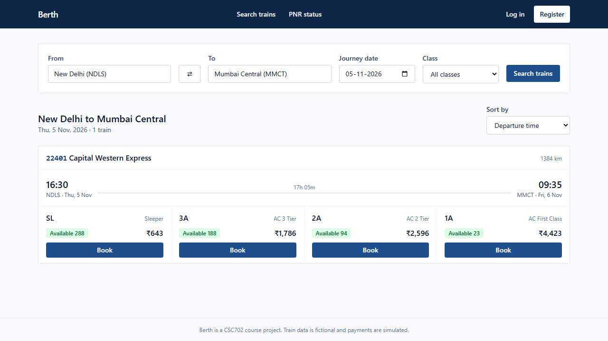<figcaption>ST-01: search results with availability and fares</figcaption></figure>
<figure>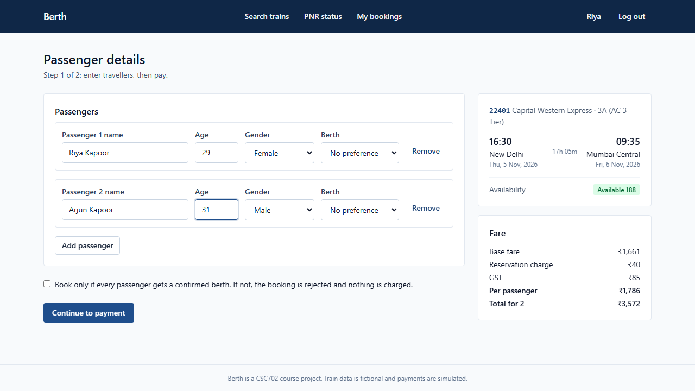<figcaption>ST-02: passenger details and fare breakdown</figcaption></figure>
<figure>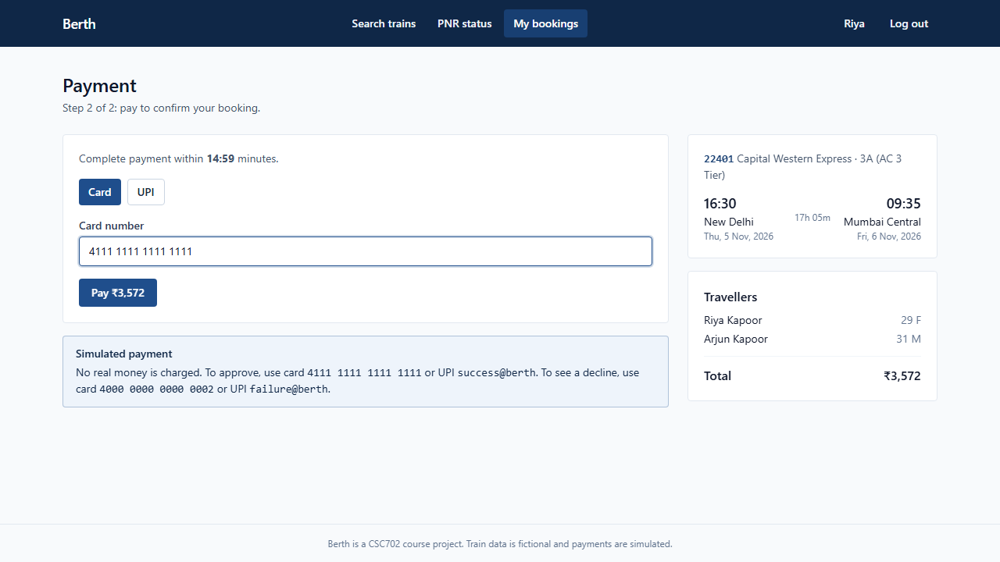<figcaption>ST-02: simulated payment</figcaption></figure>
<figure>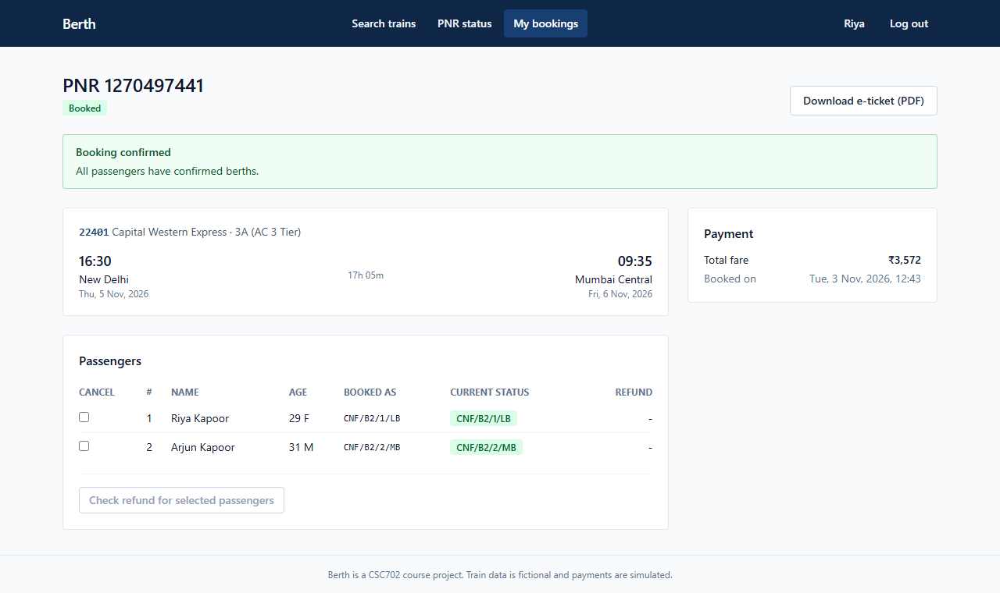<figcaption>ST-02: confirmation with PNR and berths</figcaption></figure>
<figure>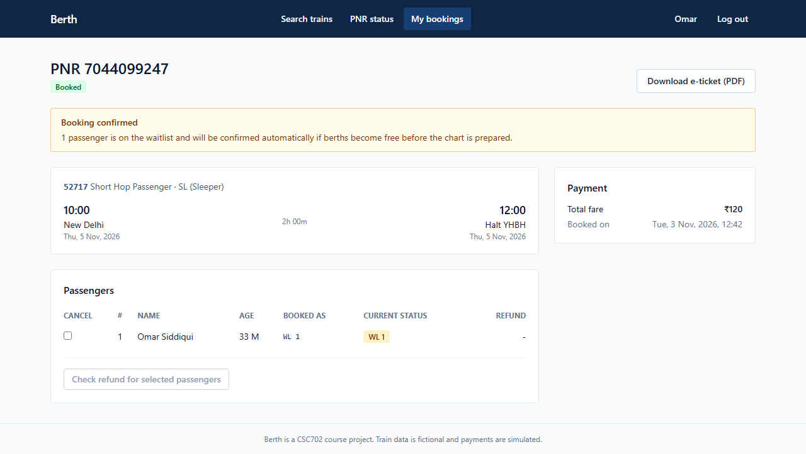<figcaption>AT-03: passenger on the waitlist (WL 1)</figcaption></figure>
<figure>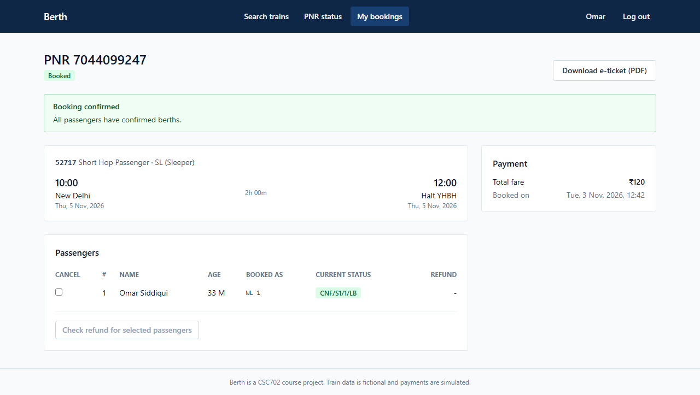<figcaption>AT-03: confirmed automatically after a cancellation</figcaption></figure>
<figure>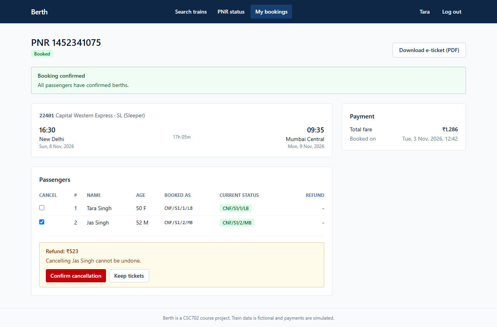<figcaption>AT-04: refund shown before confirming</figcaption></figure>
<figure>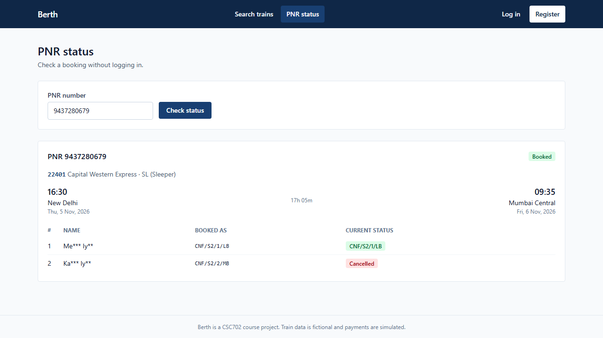<figcaption>ST-05: public PNR status with masked names</figcaption></figure>
<figure>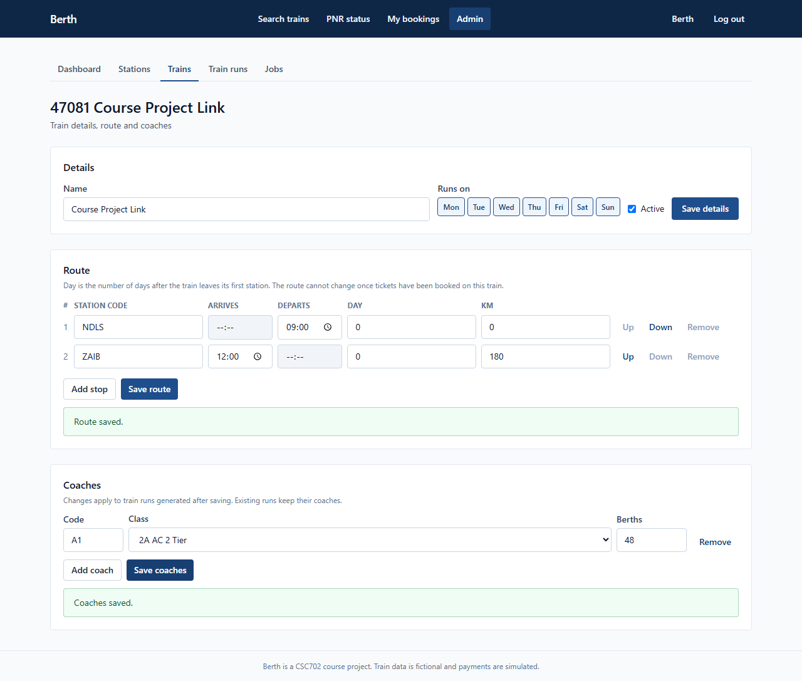<figcaption>ST-06: admin train, route and coach editor</figcaption></figure>
<figure>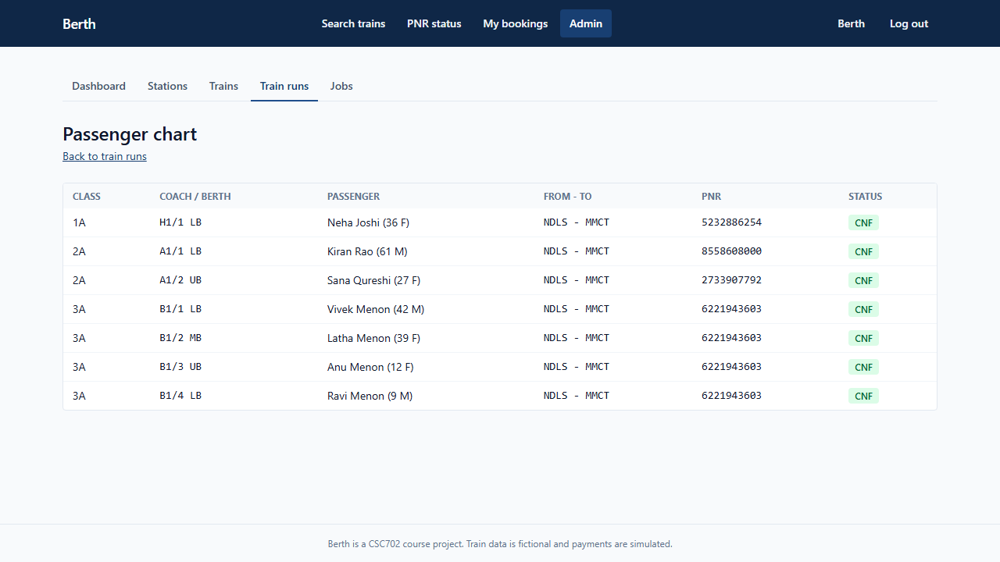<figcaption>ST-07: passenger chart</figcaption></figure>
<figure>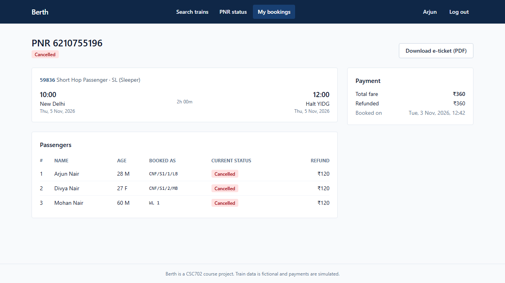<figcaption>AT-08: train run cancelled, full refund</figcaption></figure>
<figure>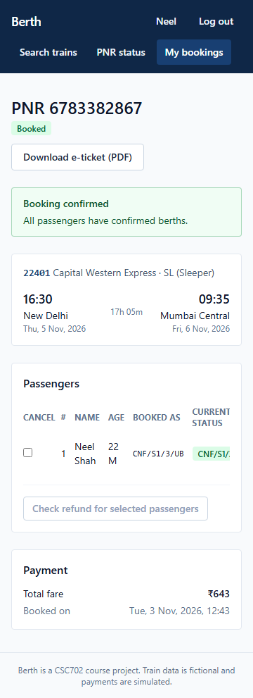<figcaption>ST-08: confirmation at 360 px</figcaption></figure>

